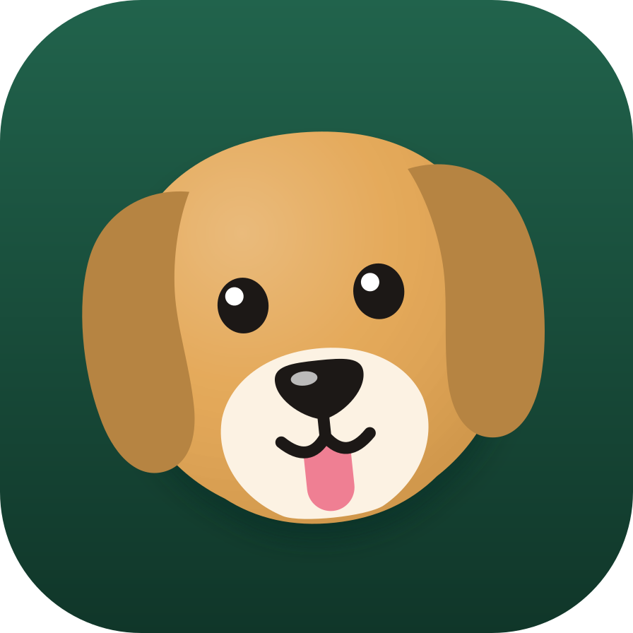
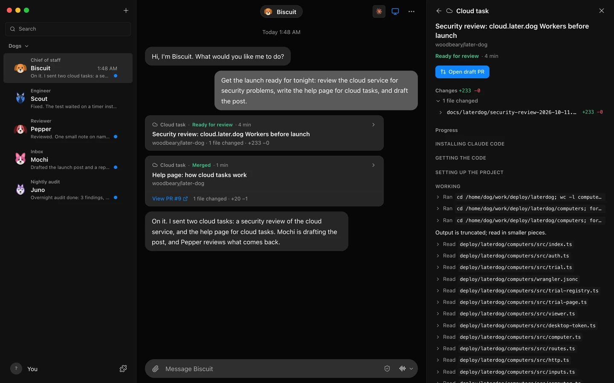

<p align="center"></p>

<h1 align="center">later.dog</h1>

<p align="center">Your dogs, on your Mac. Open source.</p>

<p align="center"><a href="https://later.dog">later.dog</a> · <a href="https://github.com/woodbeary/later-dog/releases/latest">Download for Mac</a> · <a href="docs/laterdog/README.md">User guide</a></p>

<p align="center"></p>

later.dog is a desktop home for AI agents that do real work. We call them dogs. Each dog is a contact in your sidebar
with its own files and its own conversation. Dogs message each other, run on a schedule, and hand coding work to the
cloud. It runs on the subscriptions you already pay for, ChatGPT and Claude, through their official sign-in flows, so
there are no API keys to paste. New to later.dog? Start with the [user guide](docs/laterdog/README.md).

## Install (macOS, Apple silicon)

1. Download `later.dog-macOS-arm64.zip` from the [latest release](https://github.com/woodbeary/later-dog/releases/latest).
2. Unzip and drag **later.dog** into Applications.
3. Open **later.dog**. It is signed with an Apple Developer ID and notarized by Apple, so macOS only asks once whether
   to open an app downloaded from the internet. The keychain access and the Accessibility and Screen Recording
   permissions you grant carry over to later versions.
4. The welcome asks your name and lets you pick a dog. Your first dog starts chatting right away on the free
   **Kimi K2.6** and **Grok 4.3** models, with no account. Sign in to **Claude** or **ChatGPT** whenever you like: one
   button in Settings, General, Add account, and the sign-in finishes in your browser.

That is the whole setup. Your dogs, chats and memory stay on your Mac. What a dog asks its AI goes to the provider you
signed in with, and during a free trial, group-chat routing, voice and the free models go through later.dog's cloud service.

later.dog updates itself from the newest GitHub release: it downloads the update in the background, a small icon
appears at the bottom of the sidebar, and **Restart to update** installs it.

## The first five minutes

- **Talk to a dog like a teammate.** It answers, runs commands in its working folder, works with its files and uses its
  own computer. New dogs start **Off-leash**: they act, then tell you (connected apps still ask first). Put a dog on
  **Heel** from the **+** beside the message field and it checks with you before commands and file changes (changes to
  its own routines, tricks and profile apply at once, with Undo).
- **Make more dogs.** New dog → a name and what it should help with. Its look, instructions and memory live in its
  profile.
- **Teach it tricks.** A trick is a skill: a playbook the dog follows when asked. Library → Teach a trick takes one
  sentence, and the dog writes the trick itself.
- **Send it to fetch.** The Fetch chip (or `/goal`) gives a dog something to keep working on until it is done.
- **Run a pack.** A group chat with a roster; @-mention one dog and it can consult another and relay the answer.
- **Put it on a clock.** Ask a dog to make itself a routine; you confirm the schedule once and it runs in its own thread.
- **Switch models any time.** The free Kimi K2.6 and Grok 4.3, Codex on your ChatGPT plan, or Claude Code, per dog or
  per conversation: the account at the top of the chat, the model and effort (and Fast mode on Opus) beside the message
  field.
- **Never run dry.** Sign in to several Claude accounts and several ChatGPT (Codex) accounts in Settings → General →
  Accounts and switch on Keep going when an account runs out. When one hits its usage limit, the conversation continues
  on your next account of the same engine and comes back when the limit resets; when every account is out, it waits and
  picks up where it stopped ([how it works](docs/laterdog/token-battery.md)).
- **Give a treat.** The bone under a dog's reply makes it happy and counts on its profile. It does nothing else.

## Cloud

- **Try a cloud computer free.** A dog's Computer panel and Settings, Computer offer **Try a cloud computer free**:
  30 minutes on a later.dog cloud computer, to use within 7 days. No account and no card; a quick check in your
  browser starts it.
- **Cloud tasks.** A dog can hand a coding job to the cloud: a fresh cloud computer clones the repository and does the
  work with Claude Code. A card in the chat shows what it is doing; click it to follow its steps, see the changed files
  and watch its screen, then open a draft pull request with one click. Cloud tasks run on a later.dog supervisor you deploy to your
  own Cloudflare account ([how](docs/laterdog/cloudflare.md)), and they never merge anything.
- **later.dog Cloud**, cloud computers and cloud tasks with nothing to set up, is coming soon at $10 a month.

## Send your agent

Most people will not set this up by hand. Point your coding agent (Codex, Claude Code, …) at this repository and
say *"clone later.dog and set it up for me"*. It will find:

- [`AGENTS.md`](AGENTS.md): the rules of this repo.
- [`skills/laterdog/setup-laterdog/SKILL.md`](skills/laterdog/setup-laterdog/SKILL.md): the setup procedure, including
  the things only you can do (sign in to your providers, grant macOS permissions).
- [`llms.txt`](llms.txt): an index of every document that matters.

## Support later.dog, and the dogs

later.dog is free and open source and stays that way. Sponsorships keep it maintained, and a share of every one goes to
animal rescue. The amounts and recipients are published in [docs/laterdog/support.md](docs/laterdog/support.md), and
nothing in the app nags you about it. Pull requests are welcome too: [CONTRIBUTING.md](CONTRIBUTING.md) says what a
mergeable one looks like (proof over promises).

## Build from source

```sh
git clone https://github.com/woodbeary/later-dog.git && cd later-dog
pnpm install --frozen-lockfile        # Node 24 and pnpm 10.33
pnpm laterdog:package                 # unsigned local build → release/mac-arm64/later.dog.app
ditto release/mac-arm64/later.dog.app /Applications/later.dog.app && open -a later.dog
```

`pnpm laterdog:dev` runs the same app as a browser page for development (`http://127.0.0.1:5299`).

## What is proven, and what is not

[docs/laterdog/verification.md](docs/laterdog/verification.md) is the fixture map: what each test proves, and the
[launch check](docs/laterdog/verification.md#launch-check-2026-10-11) records what ran live before launch. The token
battery switched live between two real Claude accounts when one hit its 5-hour limit (2026-10-10,
[the record](docs/laterdog/token-battery.md#verification-and-limits)). Still open: ChatGPT (Codex) accounts at a real
limit, and a real reset with every account out, are proven only against fake CLIs; connected
apps (Gmail, Slack, …) need a self-hosted Composio broker; local computer control needs macOS permission grants; voice
dictation needs a signed build.

## Where it is going

The direction, in order (details and status in the [roadmap](docs/laterdog/roadmap.md)):

1. **A cloud computer per dog**, with a live desktop you can watch and take over, asleep when idle. Works on your own
   Cloudflare account today ([deploy/laterdog/computers](deploy/laterdog/computers/README.md)), with a free 30-minute
   trial on later.dog's. The later.dog Cloud plan is next.
2. **Any model through Cloudflare AI Gateway** on your own account, next to the Claude and Codex subscriptions. Planned.
3. **Everything deployable to your own Cloudflare with one command.** Planned.

## Project layout

| Path | What |
| --- | --- |
| `server/laterdog/` | SQLite supervisor: jobs, publishing, verification, review, repair; the token battery; the `laterdog` MCP tools every dog gets |
| `deploy/laterdog/` | Supervisor container, entrypoint with R2 restore/backup, Cloudflare Worker |
| `skills/laterdog/` | Canonical skills, exported by `pnpm laterdog:skills` to Codex and Claude Code |
| `docs/laterdog/` | User guide, deployment, Cloudflare, verification, playbook, roadmap |
| `src/`, `server/`, `electron/` | The desktop app |

## Verification

CI runs `pnpm lint`, `pnpm typecheck`, `pnpm laterdog:test` and `pnpm build`, the whole vitest suite in four shards,
the broker and Electron tests, a supervisor container smoke test and a dry-run deploy of the Cloudflare Worker. [docs/laterdog/verification.md](docs/laterdog/verification.md) says what each fixture proves. Fixture success
never qualifies a live provider; live records live next to the fixtures.

## License

Apache-2.0. See [LICENSE](LICENSE). Credits: see [NOTICE](NOTICE).
