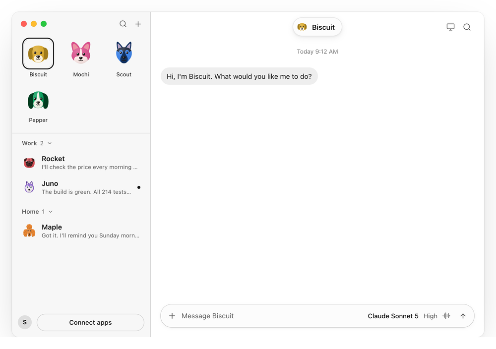
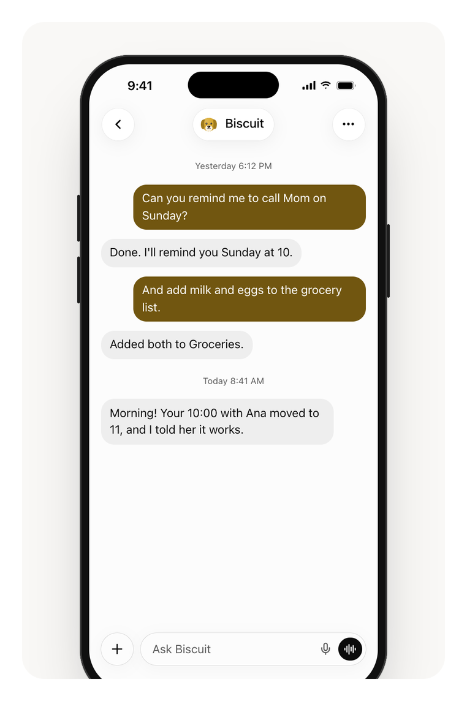
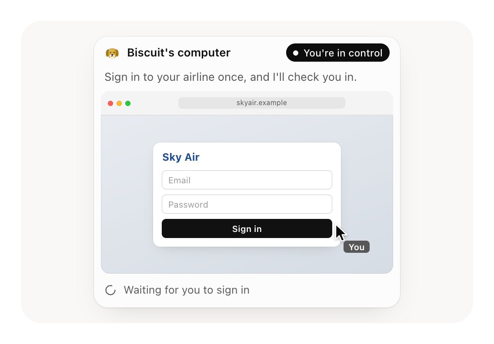
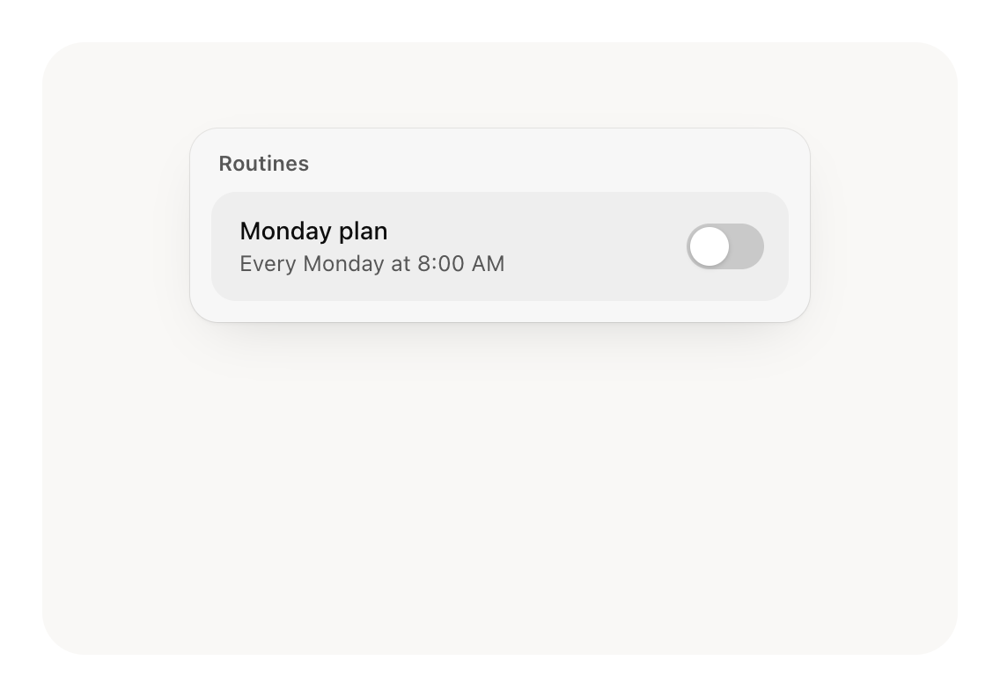
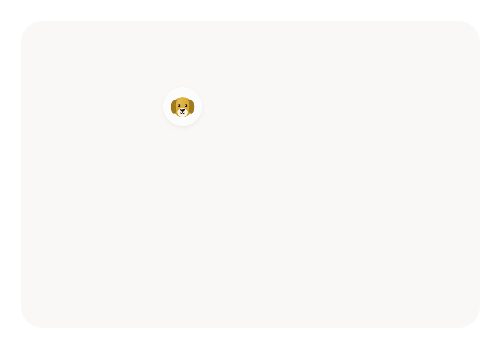
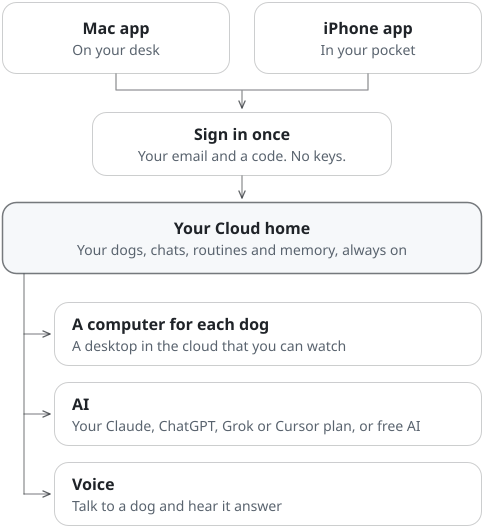
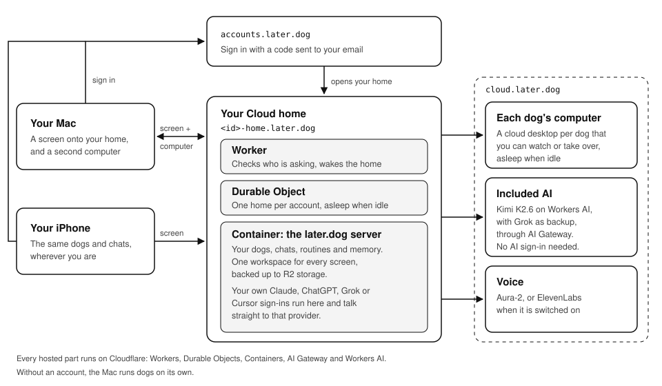

<p align="center"><a href="https://later.dog"></a></p>

<h1 align="center">later.dog</h1>

<p align="center"><b>Super dog intelligence.</b><br>
AI teammates you can give real work to, on your Mac and iPhone.<br>
Start free, or use the Claude, ChatGPT, Grok or Cursor plan you already have.</p>

<p align="center">
  <a href="https://github.com/woodbeary/later-dog/releases/latest"></a>
  <a href="https://testflight.apple.com/join/UH46TVvC"></a>
  <a href="LICENSE"></a>
</p>

<p align="center">
  <a href="https://github.com/woodbeary/later-dog/releases/latest"><picture><source media="(prefers-color-scheme: dark)" srcset="docs/assets/readme/download-mac-dark.svg"></picture></a>
  &nbsp;
  <a href="https://testflight.apple.com/join/UH46TVvC"><picture><source media="(prefers-color-scheme: dark)" srcset="docs/assets/readme/iphone-beta-dark.svg"></picture></a>
</p>

<p align="center">
  <picture>
    <source media="(prefers-color-scheme: dark)" srcset="docs/assets/readme/hero-dark.webp">
    
  </picture>
</p>

<p align="center">Ask for real work. Your dog checks your accounts, asks another dog for help, uses its own computer, and comes back with it done. Say "every Monday" and it keeps doing it.</p>


<h3 align="center">Message your dogs like teammates</h3>

<p align="center">Give a dog a task the way you would ask someone you work with, from your <b>Mac</b> or your <b>iPhone</b>. Sign in with the same email on both and the same dogs and chats are there.</p>

<p align="center">
  <picture>
    <source media="(prefers-color-scheme: dark)" srcset="docs/assets/readme/phone-dark.webp">
    
  </picture>
</p>

<h3 align="center">Works on its own computer</h3>

<p align="center">Each dog has a computer of its own that you can watch. When a site needs you, you <b>sign in once</b> and the dog takes it from there.</p>

<p align="center">
  <picture>
    <source media="(prefers-color-scheme: dark)" srcset="docs/assets/readme/computer-dark.webp">
    
  </picture>
</p>

<h3 align="center">Runs on a schedule</h3>

<p align="center">Ask for something every morning or every Monday. It runs on time, <b>even when your Mac is closed</b>.</p>

<p align="center">
  <picture>
    <source media="(prefers-color-scheme: dark)" srcset="docs/assets/readme/schedule-dark.webp">
    
  </picture>
</p>

<h3 align="center">Dogs help each other</h3>

<p align="center">Make a dog for each part of your life. A dog can ask another for help and fold the answer into its reply. You can always read what they said to each other.</p>

<p align="center">
  <picture>
    <source media="(prefers-color-scheme: dark)" srcset="docs/assets/readme/helpers-dark.webp">
    
  </picture>
</p>

<h3 align="center">Use the AI you already have</h3>

<p align="center">Start on the <b>free AI</b> that comes with later.dog. When you want more, sign in to <b>Claude</b>, <b>ChatGPT</b>, <b>Grok</b> or <b>Cursor</b> with the plan you already pay for. No API keys.</p>


## How it works

<p align="center">
  <picture>
    <source media="(prefers-color-scheme: dark)" srcset="docs/assets/readme/how-it-works-dark.svg">
    
  </picture>
</p>

- **Sign in and go.** Type your email, enter the code, and your dogs are there. No keys, no setup.
- **One home for everything.** Your dogs, chats, routines and memory live in your Cloud home, which is always on. The
  Mac and the iPhone are two windows onto the same place.
- **Your Mac can help too.** While it is signed in, your dogs can use it as a second computer, for a file in Downloads
  or an app only you have. Without an account, the Mac runs your dogs on its own.
- **Talk out loud.** Talk to a dog and hear it answer.

## Download

- **Mac** (Apple silicon): [download the latest release](https://github.com/woodbeary/later-dog/releases/latest), drag
  later.dog to Applications and open it. It is signed, checked by Apple, and keeps itself up to date.
- **iPhone**: a free beta on [TestFlight](https://testflight.apple.com/join/UH46TVvC). Sign in with the same email.
- **Free to start.** The app is free and open source. Signing in gives you a Cloud home with an included allowance of
  computer time, AI and voice.

More at [later.dog](https://later.dog), and the [user guide](docs/laterdog/README.md) covers every screen.

---

## For developers

### Under the hood

<p align="center"><a href="docs/assets/architecture.svg"></a></p>

The Cloud home is a Cloudflare Worker with a Durable Object and a Container running the same later.dog server as the
desktop app; your Claude, ChatGPT, Grok or Cursor sign-ins run in that Container and talk straight to the provider.
`accounts.later.dog` handles email sign-in, and `cloud.later.dog` gives each dog its computer, the included AI (Kimi
K2.6 with Grok as backup, through AI Gateway) and voice (Aura-2, or ElevenLabs where it is switched on). Without an
account, the Mac runs dogs on its own and the app can offer the same allowance as a $10-a-month plan.

### Build from source

```sh
git clone https://github.com/woodbeary/later-dog.git && cd later-dog
pnpm install --frozen-lockfile        # Node 24 and pnpm 10.33
pnpm laterdog:package                 # unsigned local build → release/mac-arm64/later.dog.app
```

The released `later.dog-macOS-arm64.dmg` is signed and notarized and updates itself (**Restart to update**).

Coding agents: start with [`AGENTS.md`](AGENTS.md), the
[setup skill](skills/laterdog/setup-laterdog/SKILL.md) and [`llms.txt`](llms.txt).

### Project layout

| Path | What |
| --- | --- |
| `src/`, `server/`, `electron/` | The desktop app and the later.dog server (the same server runs in the Cloud home) |
| `deploy/laterdog/home/` | The Cloud home: Worker, Durable Object and Container |
| `deploy/laterdog/computers/` | `cloud.later.dog`: each dog's computer, the included AI, voice, trials and the plan |
| `cloudflare/control-plane/` | `accounts.later.dog`: email sign-in and accounts |
| `skills/laterdog/` | Canonical agent skills, exported by `pnpm laterdog:skills` |
| `docs/` | [User guide](docs/laterdog/README.md), [Cloud home contract](docs/cloud-pro.md), [verification](docs/verification/README.md) |
| `docs/assets/readme/` | The animations and diagram on this page, recorded from the [later.dog](https://later.dog) site's own scenes |
| `scripts/readme-media/` | Records those scenes from a local build of the site and encodes them (`render.mjs`), and draws the diagram (`how-it-works.mjs`) |

Current screenshots of the app live in [`docs/assets/screenshots/`](docs/assets/screenshots/README.md), taken from an
isolated fixture, never from someone's real data.

### What is proven, and what is not

CI runs lint, typecheck, the vitest suite, the Electron tests and the builds on every pull request.
[docs/verification/README.md](docs/verification/README.md) says how each change is proven on an isolated fixture, and
[docs/laterdog/verification.md](docs/laterdog/verification.md) keeps the live records. Fixture success never qualifies
a live provider.

### Support, security, license

- later.dog stays free; sponsorships help, and a share goes to animal rescue ([support.md](docs/laterdog/support.md)).
- Pull requests welcome: [CONTRIBUTING.md](CONTRIBUTING.md). Security problems: [SECURITY.md](SECURITY.md), never a
  public issue.
- Apache-2.0, see [LICENSE](LICENSE). Credits: [NOTICE](NOTICE).
