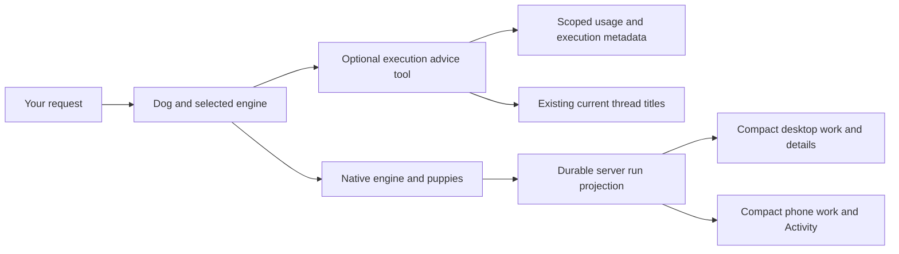

# Consolidation release: November 8–9, 2026

## What this release owns

Later.dog keeps its existing conversation, account, engine and supervisor owners. The release adds a durable view of native work, makes model execution visible, and exposes an optional evidence tool. It does not add another scheduler or a mandatory classifier before every message. Your selected account, model and effort remain authoritative.

Publication, server activation, provider behavior and installed-device behavior are separate checks. The receipts below distinguish them. Synthetic replies are not task-quality labels; recorded usage is not a subscription invoice.

## Before and after

| Your workflow | Before | Result |
| --- | --- | --- |
| Desktop account controls | The saved account on/off setting was absent from desktop rows | Signed-in account rows expose a Use switch through the existing enabled PATCH, with success/refusal fixtures; no live account was toggled for QA |
| Grok and Kimi queues | Stale completed account checks could leave fallback seeing an older snapshot | The registry consumes the latest completed check; unopened-chat/queue fixtures pass and isolated real Grok/Kimi turns complete. Originally stopped live chats were not replayed |
| Watching many dogs and puppies | Transient helper snapshots could disappear after a parent finished or a client reconnected | Server-owned native identities, retained history and explicit incomplete/interrupted observations |
| Understanding current work | Progress, helper state and transcript details were derived separately | One compact native row, at most five selectable puppies and overflow into one detail surface; the phone reuses Activity |
| Changing a model during work | Selected settings could be confused with the execution already running | Current-versus-next notices appear only when authoritative account/model facts establish a difference |
| Asking which model to use | No bounded, private evidence tool | Optional `execution_advice` reports eligible accounts/models, usage, duration, catalog prices and evidence gaps; it preserves the current selection |
| Processing large advice histories | Repeated account/model scans and duplicate private JSON | Per-query grouping and one JSON representation; no retained aggregation cache |
| Keeping task context | Task titles were copied into ledger execution metadata | New records omit title text; the advisor reads authorized current titles from the existing thread store only when called |
| Hot log storage | Inactive logs remained on the home disk | Hash-checked archive upload precedes removal; history restores on demand while active engine/workspace state stays hot |
| Cloud configuration | Obsolete checked-in image tags and an ad hoc deployment configuration could replace live settings | Final immutable image references and saved account settings are reconciled before deployment |

This consolidates ownership and interaction. It is not a net lines-of-code reduction: durable storage, contracts and verification add code. The phone consumes a generated immutable contract and pure selectors instead of independently inventing native lifecycle rules. It retains at most forty live run snapshots per thread, reloads paginated history on focus/reconnect, and keeps legacy progress visible if native history is unavailable, stale or unrelated to the current parent. Streaming replies stay visible. Provider-resolved questions and permissions remain neutral rather than appearing granted or answered.

## What the inventory actually establishes

The observed workflow is ongoing repository work, cloud verification and production release checks, coordinated from Clover to Patch while other dogs remain stopped. You expect long work to continue across restarts without opening each chat, and phone/desktop views to agree about the model actually running. Your reported account switches, queued Grok/Kimi messages and selected-versus-fallback confusion are the concrete cases behind these changes.

The fleet snapshot contains eighty dogs. The live thirty-day execution endpoint at 02:26:47 UTC reported 1,775 recorded turns, five new execution receipts and 1,770 legacy turns; none of those five receipts has an independently verified task result. The five cover three Claude Opus 5.5 executions and two GPT-6.1 Sol executions. This small newly instrumented sample cannot rank the available models. During the release only Patch was working; Clover and Patch retained Codex, `gpt-6.1-sol`, Medium. The other dogs were not resumed. The release did not send synthetic QA messages to any live user dog.

A read-only production restore-manifest inventory on November 9 contained 121,620 entries and approximately 13.4 GB of recorded file sizes. Its largest categories included 4.27 GB in task workspaces, 2.94 GB in provider state, 1.47 GB in Claude project state, 533 MB in native engine state, 509 MB in the message database, 492 MB in events and 452 MB across 22,601 tool-result entries. These are logical manifest observations, not billed storage, physical disk usage or a count of independent conversations. No workspace, credential, transcript or historical ledger file was deleted for this inventory.

The useful evidence sources have different meanings:

| Source | What it can establish | What it cannot establish alone |
| --- | --- | --- |
| Conversation/task store | Requested work, current titles and ownership | A historical model-quality label after a title changes |
| Native engine events and durable runs | Actor identity, ancestry, provider-reported activity and completion | Independently correct task results |
| Usage ledger | Recorded tokens/cost fields, selection, dispatch and execution duration | Subscription invoices, full retry cost or queue latency |
| Supervisor receipts | Published branches, exact heads, checks and review findings | Installed-device behavior or a passed blocked legacy gate |
| Restore manifest and archive counters | Retained state and cumulative uploads | Causal net free-disk gains during concurrent writes |
| Synthetic fixtures | Reproducible isolation, transitions, permissions and restart behavior | General live capacity, battery, thermals or model superiority |

This is an inventory of the accessed stores, source and retained receipts. It is not a claim that every historical conversation was exhaustively reviewed.

## Decision capability already present

The inspected computers service already exposes a bounded `decide` MCP tool with
Clef or Clef-flash, typed choice/score/noul questions, up to four questions and
optional images. It requires an active Cloud plan and has a separate free-form
decision allowance. Its `computer_action` path executes an action and applies a
Clef-flash screen check to fresh screenshots; it is not a new DOM-grounded action
selection loop. The source is [the existing tool catalog](../../deploy/laterdog/computers/src/mcp-tools.ts)
and [screen check](../../deploy/laterdog/computers/src/mcp-screen.ts). Availability
to a particular dog depends on that client's connected tools; this release does
not register a new decision client into every native session.

At 02:52:45 UTC, the production config endpoint reported the existing decider
configured, included and enabled, with room routing on. The public provider label
is `jev`, describing its protocol; the included service implementation dispatches
to Cloudflare's Clef model. [Room routing](../../server/decider/room-routing.ts)
selects a responder from allowed room members, with a bounded timeout and fallback.
This is not model/effort selection. Configuration and source were inspected here;
no new room decision or screenshot task was sent to live dogs to qualify it.

The inspected contract also has concrete scaling boundaries: 24,000 bytes of
state, up to four questions per call and at most 64 options per choice question; the service
source sets 200 free-form calls per key per day, separate from 500 room decisions
and 1,000 screen checks. Twenty workers sharing one key share those budgets.
This inventory does not change or load-test the deployed quotas. An eventual
model shortlist must fit the decision contract rather than passing every candidate
or the whole trace corpus into each step. Quota and timeout fallback must remain
explicit so an advice failure cannot leave a message queued indefinitely.

There is no reason to add a second decision-model client for the same primitive.
A future owner-authorized bridge can reuse this tool with scoped advisor evidence;
Clairic extraction and model-policy promotion remain separate, unimplemented work.
Confidence needs task-level calibration and independently checked outcomes.

## Model advice and measured efficiency

`execution_advice` is a dog-callable, read-only tool with no external inference call and no new credential. It reads only the asking dog's thirty-day history. Shared or guest-driven work is restricted to the current conversation; an expired turn capability is rejected. Canonical title lookup happens only after that scope filter. The advisor does not add task text to usage evidence or its own persistent store. Existing engine/conversation tool traces can retain arguments and results under their existing retention rules. Selected and dispatched effort, variant and fast settings survive evidence parsing.

Legacy `execution.task` and unknown execution fields are stripped on read and on new append without losing a valid usage row. Existing month files are not rewritten: old title copies remain at rest. Sanitizing responses is not a historical purge.

The owner/admin inventory can inspect workspace-wide receipt coverage, but the
dog-callable tool intentionally remains scoped to its own dog/current thread.
It does not aggregate every worker's private history for a chief of staff. Its
current statistics group by account and model. Effort, variant and fast settings
are retained in execution evidence but do not stratify these statistics;
engine-version provenance is not yet joined. These are not controlled comparisons.
An owner-authorized aggregate using existing turn identities is future work,
with the same permission boundary rather than another stored conversation copy.

The tool always returns `keep_current` because no controlled, independently verified comparison dataset is connected. API list rates have source dates and are not plan invoices. Duration excludes queueing, previous failed attempts and later rescue. Current-title word overlap is a retrieval aid, not a semantic quality judgment. Provider success stays `unverified` task completion.

The retained canonical-title benchmark at 02:35:22 UTC on November 9 ran on an
eight-core Apple M1, Node 24.22.1, 8 GB RAM, load about 2.1, with active workloads
and no certified idle host:

| History rows / 100 candidates | Repeated scans, median | Grouped query, median |
| --- | ---: | ---: |
| 50 | 0.183 ms | 0.160 ms |
| 2,000 | 2.17 ms | 1.10 ms |
| 100,000 | 144.87 ms | 56.01 ms |

Each size retained five alternating pairs after warm-up. All 103 complete-reply
comparisons matched. The old implementation's title lookup and one limitation
sentence were normalized to the same canonical-title semantics; its repeated-scan
algorithm remained intact. The timer includes calculation and JSON serialization,
excluding ledger reads, HTTP and model work. The absolute fifty-row effect is too
small for a user-facing improvement claim. [Raw output](execution-advisor-canonical-2026-11-09.json)
retains every sample and host facts; [the scale recipe](execution-advisor-scale.md)
keeps separately attributed historical and independent cloud runs. These results
establish a narrower calculation improvement, not a user-visible speedup, lower
model bill or production capacity.

## Cost context, checked November 9

The deployed home is configured for 12 GiB memory, four vCPUs and a 20 GB disk.
[Cloudflare's container rates](https://developers.cloudflare.com/containers/platform/pricing/)
charge provisioned memory/disk while running and active CPU usage. A 30-day,
always-running home would have a gross memory component of $77.76 and disk
component of $3.63, before shared allowances, credits and other services. CPU is
$0.000020 per active vCPU-second; four fully active vCPUs for all thirty days
would add $207.36. These are rate-based scenarios, not this account's invoice.
Workers, Durable Objects, logs, network and storage also need their own usage.
Idle workers that sleep and right-sized computers matter to the per-dog design.
No actual bill reduction is claimed.

The existing Workers AI decision/extraction endpoints have these current input
rates and context windows:

| Endpoint | Input / million tokens | Context | 1,000 calls at 2,000 billed input tokens each |
| --- | ---: | ---: | ---: |
| [Clef](https://developers.cloudflare.com/workers-ai/models/clef/) | $0.24 | 65,536 | $0.48 |
| [Clef-flash](https://developers.cloudflare.com/workers-ai/models/clef-flash/) | $0.038 | 24,576 | $0.076 |
| [Clairic preview](https://developers.cloudflare.com/workers-ai/models/clairic/) | $0.10 | 65,536 | $0.20 |

These are bounded inference-cost examples, excluding other services. They do not
establish model-selection accuracy. In particular, Clef-flash's current window is
24,576 and its listed input rate is $0.038/M; the earlier quoted 65k/$0.09 figures
are not used. State, questions and media share a finite input budget. Retrieve
scoped task facts and provenance rather than treating the entire corpus as one
classifier input; calibrate abstention against checked outcomes.

[Browser Run](https://developers.cloudflare.com/browser-run/) is a separate
hosted-browser capability. Its [paid pricing](https://developers.cloudflare.com/browser-run/pricing/)
includes ten browser-hours per month, then $0.09/hour; browser sessions also have
monthly-average concurrency charges above ten included browsers. No Browser Run
binding was found in the inspected later.dog deployments; the current container
browser remains in use. This release does not move browser sessions or deploy a
new computer-use model loop.

## Verification and publication

The final phone source is main `9312d2175001c37e59685a46e540bae9f0a516ad`. Beta OTA `336047c1-f650-4353-8287-228882f44069` is published for iOS and Android, runtime 1.0.1; rollback is `d4595dde-edc1-4894-8743-b5a2fbd26409`. Its tree passed 1,798 tests in 199 files and the complete release verifier: frozen install, TypeScript, lint with zero errors and existing warnings, iOS export, native config introspection and exact Build 9 fingerprint `945b9c2c06f193d0bc54a8c9b0740e75b799c93e`. Independent local reviews passed the shared-selector and final neutral-resolution changes. Cloud review could not clone the private phone repository; the local fallback is explicit. Publication does not prove installation on an iPhone.

The native/advisor integration in PR129 was reviewed at exact `a17c8947401341757d777e83e68d645659db1912`. A separate disposable cloud verification passed 415 checks in eighteen files, types/lint and seven actual SQLite checks. Independent combined review passed 515 tests with one skip, after an earlier native-only review correctly retained its scope-mismatch finding. The legacy publisher verification remains blocked by `spawn docker ENOENT`; separate cloud execution does not relabel that gate.

The privacy integration at reviewed head `c3f2781a2fe261158001594d318e76346d15654a` was merged as `0f92cb5e4` through PR130, retaining Patch's `5027f5692` heavy-work changes. Separate Codex local review passed with 32 focused checks. A fresh Claude cloud review also passed the exact source after 45 focused checks, the real ledger HTTP fixture, server types/lint and 103 equivalent benchmark replies. Its broader directory run had 1,723 passes and one permission-setting failure; the unchanged file and its implementation are byte-identical to the parent and the same five checks pass locally. The cloud-only cause is not established, and that broader run is not reported green. The standalone report uses a `head` field rather than the supervisor native review schema, so the retained report is cited directly rather than claiming a native gate update. Local checks passed 291 tests in eleven files, one skipped, clean types/lint and the seven-check SQLite smoke. Its complete Docker image passed health, pairing, unpaired refusal, archive bridge, two-log upload/restore and live updates using the normal tini entrypoint. The real browser fixture had already proved seven puppies, five visible plus overflow, nested selection, source/results, parent/child isolation, completion and reload on the native integration; no renderer source changed in the privacy repair.

Staging received the rebuilt image through a full Worker deployment, with its old pushed-code pointer disabled. At 02:16:39 UTC it answered direct health200 on PID21. A new Kimi turn returned the exact synthetic marker at 02:15:59 and created native run `64eb0e18d3a560eed826f2023584cee5`; its usage receipt contains no task title. Earlier complete Kimi/Grok receipts survived replacement and legacy task fields are absent from reads. These are bounded real-provider transport/completion checks, not task-quality benchmarks.

At 03:02 UTC the isolated real Kimi provider also discovered and called
`agents_execution_advice` exactly once. The durable tool record had `ok: true`,
the visible result retained `keep_current`, and Orbit remained on `kimi-k2.6` and
settled idle. [Provider-tool observations](execution-advisor-provider-2026-11-09.json)
record that bounded qualification. The retained tool preview was explicitly
shortened; it is not a complete copy of the provider response. Current advice
still lists ineligible catalog entries and can be verbose. Compacting that
presentation is a future improvement, with no claim here that the change lowered
LLM input tokens or model bills.

The earlier broad server sweep at `f56e3af76` had twelve failures across five files, plus unhandled fixture errors. The stale computer-size assertion and ledger title-copy issue were repaired; the cleanup VM, place-view and surface-pin failures are not silently called passing. Focused and full-suite evidence are kept distinct.

One authenticated Claude Code 2.1.319 native Agent child read a synthetic marker, with task and tool events correctly mapped to running then done. The initial nested CLI attempt failed because it had no inherited login and remains blocked. This qualifies one standalone foreground parser case, not the whole live server, Codex children, nested/background/parallel actors or workflows. At 02:28:14 UTC, a passive production read also observed a real Codex parent run live on Patch, with its provider limitations exposed; this does not qualify native child controls or results. Backend Stop limitations remain visible and unconfirmed stops remain retryable.

## Production and remaining device step

Full Worker `4e2cff6e-c59e-4eec-8b23-9dca6ed906ff` accepted the staged immutable
images at 02:32:14 UTC. Reviewed runtime source is `c3f2781a2`; configuration
source is runtime-equivalent main `665557400`. Traffic remained 100% on that
Worker at the end of its qualification window; the separate follow-up below superseded it. The standard image is pinned at `85ad146353a3…` and the large image at
`581e3ce682b1…`; the original promotion receipt retains those full digests. The checked-in configurations now pin the separately qualified follow-up below. All eight
live plain variables, bindings and resource sizes were preserved.

The first qualified direct sample was at 02:47:04 UTC, approximately 14 minutes
50 seconds after deployment acceptance. This is an observed activation delay,
including rollout, restore and startup; it is not an isolated file-download timer.
Saved screen responses were never counted as health. From 02:47:04 through
02:57:41 UTC, **21 consecutive functional samples over 10 minutes 36 seconds**
passed direct health, expected web asset, native history, archive availability,
sanitized execution-receipt reads and preserved dog/current-thread identities.
[Sanitized observations](consolidation-observations-2026-11-09.json) retain the
window, counts, settings, scope and storage readings.

All eighty dog ids and their current thread ids matched the pre-promotion
snapshot. This is not an exhaustive comparison of every historical thread. Both
Clover and Patch remained selected on Codex, GPT-6.1 Sol, Medium. Only Patch was
observed active in the qualified samples. The API's `botQueuedMessages` map was empty at the end; separate supervisor and account-wait mechanisms are not covered by that count.
The final receipt response contained seven execution receipts, zero legacy task
fields, all seven selected effort values, and zero verified task outcomes. Its
bounded thirty-day coverage ended at 1,776 recorded turns and 1,769 legacy turns;
these time-windowed counts are not an exhaustive data-loss check.

Natural work also demonstrated restart continuation. A new Patch parent run was
live on Codex 0.163.0 after recovery; the earlier completed and interrupted
attempts remained visible. At 02:49:55 UTC, that new run had 92 completed native
activity records, no failed activity records and two new bot text messages since
deployment. Those are activity/progress observations, not ninety-two independently
successful tools or a verified task result. No synthetic QA turn was sent to a
live user dog.

**Storage capacity is not qualified by the functional pass.** Free disk ranged
from 1,895,456,768 to 2,427,301,888 bytes; six samples had `low: true`, and the last
reading was 2,404,868,096 bytes with `low: false`. Concurrent writes continued.
No workspace, provider state or old ledger was deleted to force a green reading.
The current 20 GB home is already at the documented [default disk maximum](https://developers.cloudflare.com/containers/platform/limits/).
Workspace/engine isolation and proven archival remain material work before
claiming large live capacity. The archive remains enabled; its new process-local
upload counters start at zero. The earlier 104 uploads / 340,851,883 bytes remain
a historical cumulative observation, not new disk savings from this restart.

The release also retained an operational incident: Patch's earlier temporary
configuration cleared larger-home, always-on and dev-code account flags. Root
restored the saved settings through full Worker `474562b8`, without API patching
or deleting data. On that **pre-promotion `5027f5692` runtime**, direct health
passed at 02:22:06 UTC, and the 02:22:25 fleet/storage readings showed eighty dogs,
only Patch active and about 2.46 GB free. Those readings are separate from the
final privacy-image evidence above. Canonical production flags were already
correct; PR131 replaced obsolete image references without changing those flags.

Patch completed its release check and received another long task from Clover.
The final authorized rollout therefore used the existing restart/recovery path
rather than waiting indefinitely for global idleness. Source, settings, resources,
fleet identities and queues were captured before deployment. The running work's
post-restart progress was checked afterward; no pause command was issued.

The local Dev checkout preserves the person's unrelated `scripts/dev-mac.mjs`
edit. Server/electron changes take effect only when the person chooses
**later.dog Dev → Restart later.dog Dev**; the agent must not quit or restart that
app. Phone beta `336047c1` is published, while installed-device update uptake and
real iPhone heat, battery and crashes remain unobserved.

## Subsequent native guard rollout and final image alignment

Patch separately deployed Worker `e85c60e3-0612-493e-b065-7e250e0d6ebd` at
03:23:26 UTC from committed stage `01b206ee2`. This supersedes the original
`4e2cff6e` activation without replacing its historical measurements. Root did not
trigger another production restart to align the checked-in image references.
The standard image is now frozen at `f45ba413ad8b…`, and the large image at
`e64ff59e579d…`. Production and test configurations change only their image fields;
account flags, resource limits, bindings and test SSH settings are preserved.
Final deployment status reports 100% traffic on `e85c60e3`; the owner instance is
running application version 52 on the matching large image. All fourteen Worker
bindings are deeply equal to the previously qualified release.

Direct functional qualification began at 03:44:55 UTC, about 21 minutes 29 seconds
after Worker acceptance, and passed **21 consecutive samples over 10 minutes
8 seconds**, through 03:55:03 UTC. All eighty dog/current-thread identities and
both selected Codex / GPT-6.1 Sol / Medium settings were preserved. Only Patch
was observed active. Ten receipts retain effort, expose no legacy task field,
and contain zero independently verified task outcomes. The rolling thirty-day
coverage was 1,777 turns, ten receipts and 1,767 legacy turns.
[Separate follow-up observations](consolidation-followup-2026-11-09.json) retain
these measurements and their scope.

The sampled Worker tail contained 1,429 events, all on `e85c60e3`, and one
exception at 03:47:45 UTC: `Container port connection closed unexpectedly.`
Direct functional samples continued passing. This remains an observed transport
error; the window is not claimed error-free and its cause is not established.

Selection is not proof of execution: Patch's current native attempt reports
**Claude**, while its selected next settings remain Codex / Sol / Medium. The
prior Codex attempt is retained as stopped. A paginated read at 03:55:05 found
99 completed and one failed activity record among the first 100 records, with
more history available. This demonstrates live progress and retained failures,
not a clean task result or successful Codex execution. No settings were changed
to manufacture a matching observation.

Free disk ranged from 1,897,021,440 to 2,427,924,480 bytes, ending at
2,425,212,928; **ten samples still reported low storage**. Functional recovery
passed, but storage capacity and large live concurrency remain unqualified.
The repeated cold restores are a material cost of the current shared-home state,
not an established performance improvement.

The new native Codex shell hook has separate [mechanism and baseline evidence](engine-scaling-2026-11-08.md).
An independent local review of the committed stage passed seven focused tests;
Root's merged-source check passed 33 functional tests. A full local frozen-image
smoke also passed startup, pairing, unpaired refusal, archive restoration, live
updates and clean exit. The published dev-code bundle and rebuilt committed
source differ in raw bytes, but match after normalizing only the esbuild
dependency path prefix. This is normalized source provenance, not raw artifact
equality. A full server-suite pass is not claimed.

Root deployed those same frozen images to the isolated staging Worker
`422e1333`. Direct health returned 200 at 03:50:36 UTC; the prior real-provider
advice result, exact marker and completed native history survived. Orbit remained
on Kimi and idle. No new provider turn was sent after this last replacement;
the earlier provider-tool qualification remains distinct from this retention
check. Per-dog engine placement remains unfinished and unactivated.

## Daily-use client closing checks

At 04:01 UTC, the existing desktop window rendered the Cloud conversation and
Codex / Sol / Medium composer. Direct Cloud and desktop-proxy health, fleet and
storage responses agreed on the same PID and eighty dogs. Read-only event-stream
requests returned HTTP 200 and an initial event through both paths. These checks
observe the actual running desktop connection, alongside the isolated UI tests;
they do not measure desktop performance or qualify a new signed installer. The
connected-computer inventory also reports the existing Mac online with a fresh
poll. No live computer command was submitted as a verification probe.

The desktop Accounts screen also exposed a concrete configuration gap: the
existing ChatGPT sign-in was switched off. Root enabled it to honor the requested
Codex preference, then observed the switch on and confirmed the server reports
Codex enabled, authenticated and available at 04:07:14 UTC. This was the requested
operational account change, not a test toggle. No test message was sent to a user
dog and current work was not interrupted. The account's usage display also
reported recharge, so enabling it does not guarantee allowance. An already
running fallback attempt and the next selected model remain distinct.

The iOS beta manifest for runtime 1.0.1 resolves to update group `336047c1`, with
platform update `01a1bdef-acdc-7d76-b8be-293e25f550db`. Its 5,808,176-byte launch
bundle and all twenty-four assets downloaded with matching SHA-256 hashes using
the asset request headers declared by the update service. The initial bare asset
requests returned 403 because they omitted those declared headers; that probe
failure is not concealed as a delivery success. The correct client-protocol
requests all returned 200. Total downloaded size was 5,965,171 bytes.

The existing phone-client smoke was run again against a freshly launched isolated
server: **28/28 steps passed**, including send deduplication, streamed replies,
history, questions/permissions, group conversations and preserving computer
selection. The fixture was stopped and its evidence retained. It uses the real
phone client/state code with a synthetic engine, not a physical iPhone.

On the latest frozen staging image, fresh exact-marker turns completed on both
Grok 4.3 and Kimi K2.6, returning idle. Execution receipts match selected,
dispatched and reported models and mark provider completion successful. Their
observed send-to-idle checks were 13.697 and 8.287 seconds, respectively; these
single observations are transport checks, not latency benchmarks or task-quality
scores. Orbit's original Kimi selection was restored. The first model-setting
probe used the wrong instance and was rejected before any message was sent; the
correct Grok instance was then obtained from the existing contract. An initial
health read also observed the test home's configured sleep/wake cycle. Neither
failure is relabeled as a provider completion.

[Client closing observations](consolidation-client-readiness-2026-11-09.json)
retain these scopes. The phone's existing crash endpoint has three historical
Build 9 `ended` records, all from earlier updates and without stack diagnostics.
The phone was not connected for remote device inspection. Neither those records
nor the absence of a new report proves the latest update is installed or crash
free. Real device heat, battery and crash causes remain unqualified.

Normal Cloud-backed conversation use is already served by the active backend;
the current desktop proxy and window were observed working. Pending local helper
changes still load through the user-owned **later.dog Dev → Restart later.dog Dev**
menu action. For the newest phone UI, use **Restart to update** when offered, or
tap the version line at the bottom of phone Settings to check, download and apply
the beta update. Device uptake cannot be completed remotely from this session.

The additional closing production window passed **21 consecutive functional
samples over 607.793 seconds**, from 04:02:21 through 04:12:29 UTC, without
another production deployment. All eighty dog/current-thread identities and both
selected model settings were preserved; only Patch was observed active. Four
samples still reported low storage. Free disk ranged from 1,906,761,728
to 2,421,592,064 bytes and ended at 1,990,778,880 bytes;
capacity remains unqualified. Separate one-minute Cloud and desktop-proxy streams
each received 119 data frames and 143,619 bytes without an early disconnect. These
are bounded observation windows, not a promise of uninterrupted future service.

## Architectural priorities from this evidence

1. Keep the shared home focused on coordination. The task-workspace and provider-state inventory makes cold restore and disk headroom a concrete constraint. Patch's package reuse and Claude heavy-command hook are integrated. The subsequent native Codex guard is deployed and has the separate mechanism/functional qualification above; a live provider heavy-command denial has not been qualified. Per-dog engine placement remains unfinished. Further archival or relocation needs workspace/session-specific restore proof; deleting live engine state would break continuity. [Native container snapshots](https://developers.cloudflare.com/containers/guides/snapshots/) are a candidate for same-image restarts, but require `durable_object` scheduling, preserve no running processes, expire after thirty days without restore and cannot move across image versions. The inspected applications use `default` scheduling. No snapshot migration is deployed and no recovery code is removed on that assumption.
2. Keep native engines as the execution owners. Retain the durable projection and one Activity/detail surface; do not build a second puppy scheduler, model switcher or client recovery engine. Native history backfill still scans retained messages at startup, and expanded phone history can issue multiple detail requests; neither is claimed solved by this release.
3. Replace synchronous thirty-day ledger parsing only after measuring it in the full request. Grouping improves the pure calculation but does not bound input bytes or remove file parsing from the event loop. An indexed existing store is a smaller next boundary than a separately invalidated cache.
4. Join independently checked outcomes and engine/version provenance to existing turn/run identities before training a route. Use held-out representative tasks, record total attempts/retries/rescue/queue cost, stratify by model, effort, engine version and account path, and compare quality within a task family. Keep evaluation in shadow mode, version every candidate policy, retain explicit selection and rollback, and promote only on an independently checked benefit. Model confidence needs local calibration; feedback must not simply reward the route that chose itself.
5. Add bounded extraction or decision inference only where a measured task needs it. Existing provider decision/extraction endpoints can remain tools rather than compulsory dispatch gates. This release does not deploy a Clef/Clairic routing policy, Decisions integration or a new browser-control loop. No Browser Run binding was found in the inspected deployments; the existing container browser path remains in use. A hosted browser is a separate execution capability, not automatically bundled by putting agents on Cloudflare.

6. Use the existing supervisor as one owner of production promotion, current-head checks and rollback receipts. Other dogs can produce candidates while that owner compares frozen artifacts, live settings and actual activation. The configuration incident and consecutive cold restores show why deployment acceptance alone is insufficient. This release did not add a durable deployment lease.
7. Consolidate freshness into the shared status projection. Retained screen data and live execution health are distinct: a saved conversation can be readable while the home restores. Surface the existing freshness signals consistently on desktop and phone, and keep direct health/runtime qualification separate from cached reads. This is a remaining presentation and orchestration requirement, not a newly deployed cache.

The immediate improvement is durable, consistent work visibility and less duplicated processing/state. Automatic model quality, model-bill savings, large live concurrency and native phone performance remain measurements to earn.
