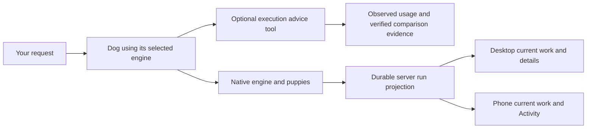

# Consolidation release: November 8, 2026

## Evidence boundaries

Publication, server activation, provider behavior and installed-device behavior are
separate checks. Synthetic replies are not task-quality labels. Costs without a
provider receipt remain unknown. Nothing here establishes an automatic best-model
router, real-device thermal improvement or general production concurrency limit.

## Before and after

| Surface | Before | Result and evidence |
| --- | --- | --- |
| Phone work details | Transient helper snapshots and separate activity derivation | Provider-reported actor identities and paginated retained history in the existing Activity screen; legacy progress survives unavailable or stale native history |
| Parent and puppy replies | A parent finishing could outlive transient helper visibility | Native child state stays separate from parent transcript and is retained by server-owned run identity |
| Advisor history aggregation | Repeated account/model scans and a duplicate private JSON representation | Per-query grouping without another retained cache; complete reply equality checked; optional advice preserves the selected model |
| Cloud log storage | Old per-thread logs occupied the hot disk | Hash-checked archive upload precedes removal; retained logs restore on demand; provider sessions and workspaces remain local |
| Selected account/model | A selection could be mistaken for the account executing a fallback | Latest phone and desktop main expose authoritative routed-account facts alongside the selected model |

The phone changes add durable visibility; they are not a claim of net lines-of-code
reduction. The consolidation is one server lifecycle owner, one existing detail
screen, one generated type reference and narrow state subscriptions. Native
scheduling and account/model ownership remain with their existing engines.

## Phone publication

PR166 merged into main at `1b4b3206d3eb2f45ae20f5dac25712f4297426fd`.
The exact implementation `8ff575ce7ea64e89d6d3ffdef949d83567ab87af` passed a separate
local review after two stale-history suppression findings were repaired. The
cloud worker could not clone the private phone repository, so that limitation
is explicit. Types match committed server `d11f590d55435a390e0bd9fd5fd96ab4d0e5496c`
byte-for-byte; the sync command and checked hash prevent unnoticed drift.

The implementation passed 1,796 tests in 199 files. The merged publication tree,
including the latest upstream routed-account change, passed 1,797 tests in those
199 files. The release verifier passed frozen install, lint, TypeScript, iOS
export and native config introspection. Lint has existing warnings and no errors.
Build 9 fingerprint matches `945b9c2c06f193d0bc54a8c9b0740e75b799c93e` exactly.

Beta update `4f712589-ea94-41c1-a8ed-db81d67e6490` published for iOS and Android,
runtime 1.0.1. Rollback is `bed5951a-9d95-4f93-b209-79c9fd294527`. The 375 px web
client sent and received a synthetic reply through an isolated server; the
Activity screen loaded with an unavailable native endpoint and no horizontal
overflow. This is not proof of installation on an iPhone or native thermal,
battery, notification or crash behavior. A long expanded history can issue
multiple detail requests while activity changes.

## Live archive

Production Worker `3b063918-d4b6-4bf6-a960-2a286c16a54b` activated the archive image.
At 00:37 UTC November 9, the authenticated production storage endpoint reported
36 archived files and 67,101,583 bytes. At 00:59 UTC it reported 103 files and
340,840,033 bytes. These are cumulative upload counters, not a claim that every
change in free disk comes from archiving. Concurrent work writes to the same disk.
The archive's isolated implementation proof is in [the archive record](log-archive-2026-11-08.md).

Clover and Patch remain selected on Codex, GPT-6.1 Sol, Medium. Passive fleet
monitoring showed Patch working; its turn was left undisturbed.

## Advisor interpretation

The independent cloud review passed exact PR128 head
`0aca4367b1adaa4b752d852350b2e2821eb80732`. It checked callers and privacy behavior,
ran 120 focused tests and reproduced equivalent replies in the benchmark. The
review does not automatically apply to a later integration head.

The local synthetic 100,000-row calculation-plus-serialization benchmark recorded
665.63 ms before and 214.95 ms after at the median. Host, raw ranges, repetitions
and timer boundaries are documented in [the scale recipe](execution-advisor-scale.md).
Those numbers exclude disk parsing, HTTP and provider work. They do not establish
a user-visible latency improvement, model quality win, subscription cost saving
or a 20-dog production capacity claim. The advisor continues to abstain from model
changes without controlled independently checked task comparisons.

## Native provider evidence

The first disposable nested-CLI check was blocked by missing login and remains a
failed qualification attempt. A second check used the already-authenticated cloud
session's native Agent tool: one foreground child read a synthetic marker and
returned it exactly on Claude Code 2.1.319. Its task_started, task_progress,
task_updated and task_notification events, Read call/result and parent_tool_use_id
were passed through the committed parser and mapped to one correctly attributed
child, running then done. The integration's native parser bytes match that source.
This qualifies one standalone parser case. It does not qualify the complete live
server, Codex, background, nested, parallel or workflow execution.

The ten-minute passive production sample window from 00:59:35 to 01:09:09 UTC
returned health200 in all20 samples. Its last archive counters were104 files and
340,851,883 bytes. Concurrent activity moved free disk between samples, so no net
free-space improvement is attributed solely to archive uploads.
