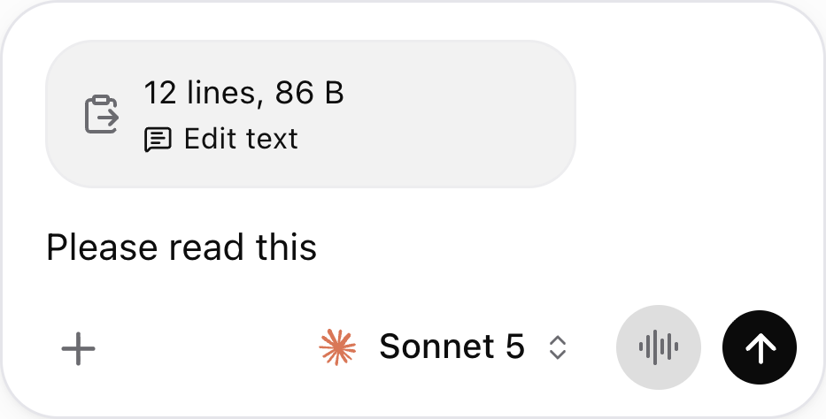
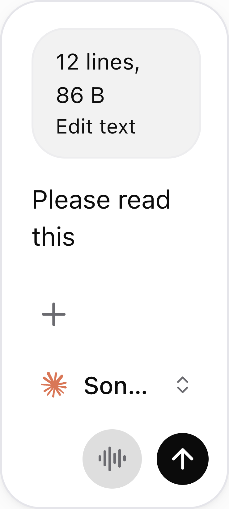
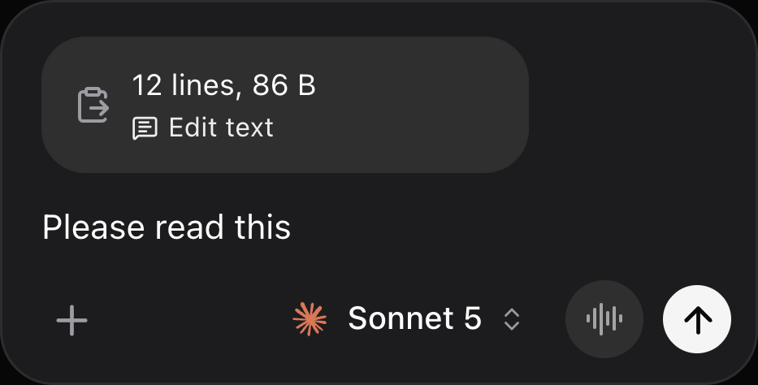
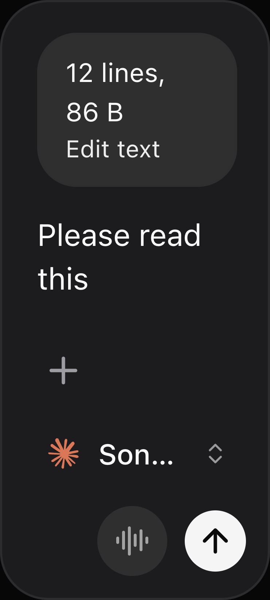

# Desktop pasted text files

Pasting at least 900 UTF-16 code units or 12 lines creates an editable attachment chip. This preserves the existing desktop cutoff and matches phone PR275 at c505797d406064c36e3c61583b0ee66554fe79d2. CRLF counts once; CR, LF, U+2028 and U+2029 count as line breaks. Ordinary short pastes remain inline.

The existing draft stays in the box. A selected part of it is replaced as with a normal paste. Each paste uploads its complete UTF-8 contents as text/plain, with names Pasted text.txt, Pasted text 2.txt and so on. Sending uses the ordinary attached-file path/name message shape. Edit text restores the paste to the composer beside the draft; Remove keeps the remaining draft.

Send waits for uploads. Completing an upload cannot restore a removed chip. Saved legacy paste drafts remain compatible, and upload failures keep the original text available. The existing 25 MB file maximum also applies to pasted text.

The chip keeps its normal 56 px minimum height. In a narrow enlarged composer, its labels wrap and decorative icons give way to text. The companion responsive composer change in PR274 is required to keep the model, voice and Send controls inside the viewport.

## Evidence

- The original newline-only detector fails three alternate-line-ending regressions. A separate unchanged-main run of the exact file-message workflow fails at its ordinary attached-file assertion: main sends the old inline pasted-text wrapper. The same test passes with the final source. Its before log is retained as paste-file-wire-before.log.
- Final focused checks: 134 passed; typecheck and lint passed. The workflow checks inspect the uploaded File contents and sent message, selected draft replacement, edit/remove, pending uploads, unique names, exact boundaries and draft clearing.
- The extracted final phone and desktop detectors agree on 224 boundary, Unicode and line-ending inputs, with zero mismatches.
- The actual App and an isolated home server accepted a 12-line accented/emoji paste. The persisted 158 UTF-8 bytes matched exactly, the stored message used the uploaded-file shape, and the draft cleared. No browser errors were observed.
- Six actual Composer browser cases passed in light/dark at 1,100 px, 375 px and 375 px with 200% CSS content zoom. Text bounds stayed inside the chip, the document did not overflow, and clicking Edit text restored the draft and removed the chip in every case. Reduced motion was enabled. All six composer crops were inspected at their original resolution.

| 375 px | 200% CSS content zoom |
| --- | --- |
|  |  |
|  |  |

The Mac evidence is retained under ~/laterdog-wt/review/desktop-overnight: paste-edit-text-focused.log, paste-edit-text-typecheck.log, paste-edit-text-lint.log, paste-edit-text-browser.log, after-edit-text/measurements.json, paste-real-flow/receipt.json and the preserved before/after capture folders. The capture and API-flow recipes are retained there too.

These are isolated renderer and server observations. Native installed-app rendering is unverified because Mac screen access is not lent. The complete final combined pnpm gate must return VERDICT: PASS before merge; focused checks and earlier-candidate gate stages do not replace that requirement.
