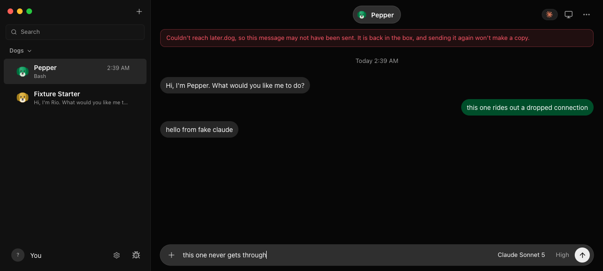
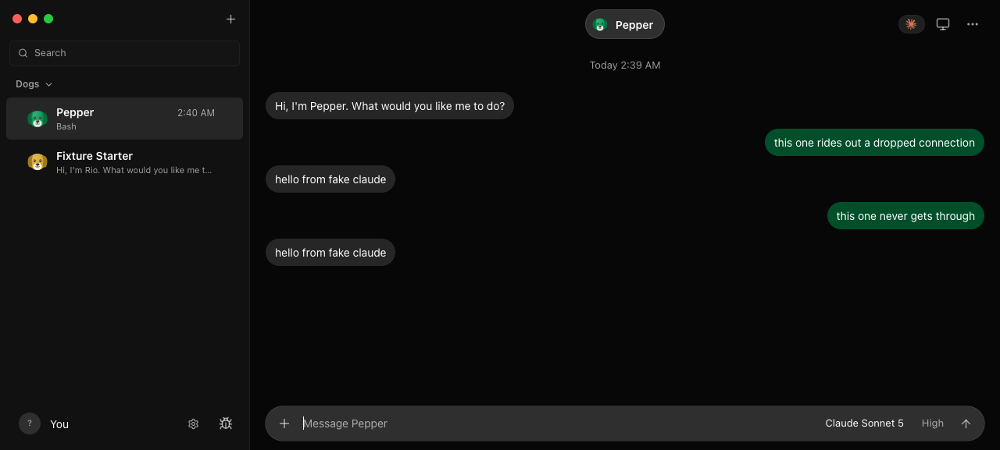

# Stability sweep

A pass over later.dog's day-to-day reliability, written 2026-10-14 on `laterdog/stability`. It follows an acceptance checklist taken from studying a comparable desktop agent app, rewritten as questions about later.dog: does a send survive a restart, does a stalled stream recover, does an approval card behave, does the app say plainly what went wrong. Every row below was run, or is marked as not run and why. Everything ran on disposable fixtures (`launchVerificationServer`, the fake engines and a 40 MB disk image); no live app, account or data was touched. Fixture success does not qualify a live provider, a signed build or the Cloud.

## Result

| | Rows |
| --- | --- |
| Pass as found | 21 |
| Failed, fixed here with a test | 9 |
| Fails, smallest fix written down | 3 |
| Differs from the reference by design | 1 |
| Rows | 34, plus what was not run at the end |

## Re-run it

```sh
pnpm exec vitest run server/stability-sweep.e2e.test.ts server/laterdog/plain-error.test.ts server/laterdog/safe-rollback.test.ts src/lib/send-retry.test.ts src/lib/plain-client-error.test.ts src/state/send-retry.test.ts --maxWorkers=1
LATERDOG_FULL_DISK_CHECK=1 pnpm exec vitest run server/full-disk.e2e.test.ts
```

The full-disk check mounts a 40 MB disk image under `/Volumes`, points the fixture's temporary home at it, fills it, and detaches it again. It runs on a Mac only, and only with that variable, so an ordinary test run never mounts anything.

The older suites the passing rows lean on:

```sh
pnpm exec vitest run server/chat-followups-restart.test.ts server/send-idempotency.test.ts src/lib/live-events.test.ts server/auto-approve.test.ts server/permission-proxy.test.ts server/respond-replay.e2e.test.ts server/command-allowlist.e2e.test.ts server/laterdog/wakeups.test.ts server/drivers/claude-tasks.test.ts server/local-vm-idle.test.ts server/cloud-computer-lazy.e2e.test.ts server/account-battery.e2e.test.ts server/claude-account-api.test.ts server/laterdog/limit-hold.test.ts server/laterdog/usage-limit.test.ts server/message-file.test.ts --maxWorkers=1
node --test electron/updater-coordinator.node-test.mjs electron/update-errors.node-test.mjs electron/update-feed.node-test.mjs electron/routine-wake.node-test.mjs
```

## Sending and live updates

| Check | Result | Evidence | Fix or smallest fix |
| --- | --- | --- | --- |
| A send survives a hard server restart and the same send id adds no second message or turn | Pass | `server/stability-sweep.e2e.test.ts` kills the fixture with SIGKILL after a reply, restarts it on the same home, repeats the POST: same message id, one user message, one engine prompt, and a different text under the same id is a 409. The queued, cancelled and uncertain follow-up cases are `server/chat-followups-restart.test.ts` (real crash, receipts, no replay). | none |
| A send survives a network drop and arrives once | Failed, fixed | Found by reading the client: `case "send"` in `src/state/store.tsx` (line 2688 before the fix) made one request with no timeout; a dropped connection removed the optimistic message and printed the browser's own wording. The server already drops copies by send id (`server/send-idempotency.ts`). Now retried five times (0.5 s to 16 s) with the same send id, 90 s per attempt. `src/state/send-retry.test.ts` drops the connection twice and checks three requests, one send id. | commit "A send that loses the network tries again with the same id" |
| In the real renderer, a dropped connection retries, gives up in plain words, and a resend is not a copy | Pass | `control-laterdog ui launch` (the real app in headless Chrome against a fixture) with `window.fetch` made to reject only message sends. Sending while dropped for three seconds: the same send id was tried four times, the last one went through, one reply. Sending while dropped throughout: six tries, one send id, then the banner in `assets/stability-sweep/send-gave-up.png` and the words back in the box. Pressing Enter again after the network returned sent that same id once and drew one reply (`assets/stability-sweep/send-resent.png`). The browser's own offline mode was not used. | none |
| An uncertain outcome never duplicates when the person sends again | Failed, fixed | The composer already restores a failed draft with its send id (`src/lib/drafts.ts`), but the other senders (call view, teach-a-trick, retry) did not. Same words in the same chat, reply and mode now reuse the id for ten minutes after a transport or 5xx failure; `src/lib/send-retry.test.ts`, `src/state/send-retry.test.ts` (resend reuses the id, a third send gets a new one). | same commit |
| A stalled live stream is noticed and resumed | Pass | The server pings every 15 s (`SSE_HEARTBEAT_MS`, `server/index.ts`); the client treats 40 s of silence as dead, reconnects with backoff, asks for the missed frames, and falls back to a fresh snapshot when the server restarted or the buffer moved on (`src/lib/live-events.ts`). `src/lib/live-events.test.ts` and the `resumed` cases in `server/index.test.ts`. | none |
| A held message queues behind earlier ones; cancelling restores the words | Pass | `server/chat-followups-restart.test.ts` (pending, cancelled, dispatching survive a crash); `Composer.tsx` restores the draft through `onError` and `onCancelled`. | none |
| Failed sends and requests read in plain words | Failed, fixed | A failed request printed `Failed to fetch` (or a bare `502 Bad Gateway`). `src/lib/plain-client-error.ts` says "Couldn't reach later.dog. Check that it's running and that you're online, then try again." and explains bare gateway statuses; `src/lib/plain-client-error.test.ts`. | same commit |





## Approvals

| Check | Result | Evidence | Fix or smallest fix |
| --- | --- | --- | --- |
| A card appears once, even if the provider asks again with the same id | Pass | `server/stability-sweep.e2e.test.ts` asks through the permission broker twice with one request id: one card, the second ask is denied at once (`createPermissionBroker`, `server/drivers/claude.ts`). | none |
| Nothing approves itself | Pass | The same test leaves a card unanswered for 2.5 s: the engine's reply stays empty, and the decision log records exactly one `user-approved` row for the one card answered. A turn that ends or is stopped denies what was pending; a dead broker denies (`server/permission-proxy.test.ts`); an unanswered card denies after 15 minutes; only Full access answers for the person (`server/auto-approve.test.ts`, including questions, which are never answered for the person). | none |
| Answering works, once | Pass | Allow returns `allowed-once`, the card shows `allow`, and a second Allow is `unavailable` with no extra "couldn't deliver" row (`server/stability-sweep.e2e.test.ts`, `server/respond-replay.e2e.test.ts`). | none |
| Refusing works | Pass | Deny reaches the engine as `deny` (`server/stability-sweep.e2e.test.ts`, `server/command-allowlist.e2e.test.ts`). | none |
| A card left open by a restart cannot be answered into an approval | Failed, fixed | Found on a fixture: ask for an approval, kill the server, restart it. The card came back still open (the waiting bar skips only answered, dismissed and expired cards), and Allow produced the honest "Couldn't deliver that answer" row only after the click. Nothing was approved, but a dead card looked live. On start, permission cards with no answer are now marked expired ("No answer in time, so this didn't happen") with the note "later.dog restarted before this was answered, so the action was not run." Questions and proposals, which can be answered later, are left alone. `server/stability-sweep.e2e.test.ts`, `server/laterdog/stale-approvals.test.ts`. | commit "An approval card left open by a restart closes as 'not run'" |

## Background work

| Check | Result | Evidence | Fix or smallest fix |
| --- | --- | --- | --- |
| Finished background helpers wake the dog once | Pass | `server/drivers/claude-tasks.test.ts` ("continues once after all background helpers settle despite reordered snapshots and duplicates"). | none |
| A desktop pulls and settles wake-ups for its dogs | Pass | `server/laterdog/wakeups.test.ts` (kept per dog until settled; refused wake-ups settle by what refused them; hosted pull). | none |
| Routines keep the Mac awake only when one is due or running, and only on power | Pass | `electron/routine-wake.node-test.mjs`. Routine runs end to end: `server/routine-continuity.e2e.test.ts`. | none |
| A computer is left asleep when idle | Pass for the local computer, not run for the Cloud | `server/local-vm-idle.test.ts`: suspends after a full idle window, never while a turn holds it, retries after a failure. The Cloud computer's own sleep is a Worker setting (`docs/laterdog/cloud-computers.md`), not exercised here. | none |
| A computer is woken or made only on use | Pass | `server/cloud-computer-lazy.e2e.test.ts`: opening the panel or chatting creates and wakes nothing; the first computer call creates it once and says so. A busy computer parks the turn and resumes it when free (`server/computer-wait.test.ts`). | none |

## Updates and accounts

| Check | Result | Evidence | Fix or smallest fix |
| --- | --- | --- | --- |
| Update flow: check, download, ready, install | Pass | `electron/updater-coordinator.node-test.mjs` (32 cases: manual and background checks, download progress, ready only after the download promise, install and restart, hand-off installs, failures that stay retryable). | none |
| A downloaded update installs only after the person says yes | Pass (fixture) | `autoInstallOnAppQuit` is off for every build (`electron/updater.mjs`), so quitting installs nothing. On macOS nothing is handed to Squirrel.Mac until the yes; then the coordinator stages it under the five-minute deadline and restarts (`electron/mac-updater.node-test.mjs` against the vendored MacUpdater). `install(version)` refuses any version other than the one downloaded, and `electron/update-receipt.mjs` makes the next launch say "Updated to X" or "The update to X didn't finish". Not yet run through `scripts/sealed-update-check.sh` on a sealed previous release. | sealed update check |
| Update errors are plain | Pass | `electron/update-errors.node-test.mjs`: a full disk says "Free some space", a bad checksum says it failed verification, nothing shows a raw code. | none |
| Update checks are spread out | Fails (minor) | The first check is 15 s after launch and then hourly with no jitter (`electron/updater.mjs`), so every install checks on the hour. | add up to five minutes of random delay to the hourly interval |
| Switching or editing an account mid-turn does not lose the turn | Pass | `server/claude-account-api.test.ts` refuses edits to an account a turn is using while sibling changes leave the running process and later events alone; `server/account-battery.e2e.test.ts` moves a running turn to another account (tools already run, a mid-turn message, rooms, routines, Codex). | none |
| Usage-limit hold and Keep going | Pass | `server/laterdog/usage-limit.test.ts` reads every limit wording; `server/laterdog/limit-hold.test.ts` holds, rechecks each minute and wakes once; `server/account-battery.e2e.test.ts` continues on another account, waits when all are resting, picks up after a reset, and stays put with the setting off. | none |

## Files

| Check | Result | Evidence | Fix or smallest fix |
| --- | --- | --- | --- |
| Size limits are enforced | Pass | Images 10 MB, files and linked files 25 MB (`server/attachments.ts`, `server/message-file.ts`), tables 10 MB, 100,000 rows, 200 columns, 500,000 cells (`src/lib/table-data.ts`, `readTableResponse`). The composer checks before uploading. | none |
| A limit says so in plain words | Failed, fixed | The server said `file exceeds 26214400 bytes`. Now "That file is bigger than 25 MB, which is the most later.dog takes. Try a smaller one." in every place that checks (`server/laterdog/plain-error.ts`, `tooBigMessage`). | commit "A full disk, a locked database or a crashed request says what happened in plain words" |
| Types the viewer cannot show | Differs by design | later.dog previews images and CSV/TSV tables in the app and saves every other type to disk; it has no text, JSON, PDF or document viewer, so there is no "too large to preview" for them. | not a failure; decide whether a text viewer is wanted |
| Linked files stay inside the conversation's folders | Pass | `server/message-file.test.ts`. | none |

## Errors and a full disk

| Check | Result | Evidence | Fix or smallest fix |
| --- | --- | --- | --- |
| A turn that ends while the disk is full | Failed, fixed | `server/full-disk.e2e.test.ts` second case, found on the 40 MB image: with the engine held and the disk filled, the turn finished but saving its end threw (`database or disk is full` at `store.patchMessage` in the turn-completed handler, `server/index.ts`). The handler stopped before marking the thread idle, so the dog stayed "working" after space returned, Stop answered ok and changed nothing, and every later message queued. Only a restart recovered it. Now a storage failure there is retried every three seconds for ten minutes (`server/laterdog/turn-end-guard.ts`, `retry-until.ts`, `recoverUnsettledTurn`), the dog goes idle once the disk allows, and the queued message runs. | commit "A turn that ends while the disk is full no longer leaves the dog working for ever" |
| A full disk while saving | Failed, fixed | Run on a real 40 MB disk image (`server/full-disk.e2e.test.ts`). Before: a send answered `cannot rollback - no transaction is active` (the rollback after SQLite had ended the transaction replaced the real error, in `server/message-db.ts` and `server/laterdog/store.ts`), and renaming a dog printed `ENOSPC: no space left on device, open '/Volumes/…/bots.json.<pid>.<uuid>.tmp'`. After: "Your Mac is almost out of space, so later.dog couldn't save that. Free up some space and try again." for both, the real error goes to the log, nothing already saved is lost, the server stays healthy, and the same send id succeeds once space returns with one copy in the chat. | commit "A full disk, a locked database or a crashed request says what happened in plain words" |
| A crashed request does not show a path, a code or a stack | Failed, fixed | The catch-all returned `e.message` for any error without a status (`server/index.ts`, the end of `handleRequest`). Errors with an errno code, a stack, a database word or a built-in error type now read "Something went wrong on this computer, so that didn't go through. Try again, and if it keeps happening, quit and reopen later.dog."; the original is logged. `server/laterdog/plain-error.test.ts` (6 shapes). Deliberate messages and their statuses are unchanged. | same commit |
| A rejected request names what was wrong | Failed, fixed | A malformed request answered with the validation library's JSON report (`[ { "expected": "string", "code": "invalid_type", ... } ]`). It now reads "That wasn't something later.dog could use (name: Invalid input: expected string, received array). Check it and try again." Twelve different failing requests are checked for stack lines, errno names, paths, `undefined` and byte counts in `server/stability-sweep.e2e.test.ts`. | commit "A bad request names the field that was wrong" |
| No error says "the user" | Pass | `grep` over `src/`, `shared/` and the English catalogue: none reach the person. The hits under `server/` are prompts addressed to the model (`system-prompt.ts`, `surface.ts`, `setup-mode.ts`) and a tool result for the model (`mcp-registry.ts`), which tell the dog never to say it to the person. | none |
| A failed turn explains itself | Fails (minor) | An engine that exits early shows `claude exited 3 before result: <last 300 characters of its stderr>` (`server/drivers/claude.ts`, two places), which can be a stack. Account limits, sign-in and overload read well (see below). | keep the code and stderr in the log and show "Claude stopped unexpectedly. Try again." with a Details row |
| Account switch failures | Fails (minor) | `Could not continue on <account>: <raw message>` (`server/laterdog/continue-on-account.ts`, `server/laterdog/carry-on.ts`, `server/index.ts` near line 6056) append the raw message. | run the message through `plainFailure` |

Failed-turn rows seen on the fixture: the usage limit, "Not logged in" and an overloaded API all arrive as plain sentences with their own actions (reset time, sign-in, retry). A bot already set to Claude whose command has gone missing was not exercised.

## Rows that fail and are not fixed here

1. Failed-turn text for an engine that exits (see above): small, but it changes strings in `server/drivers/claude.ts`, which other lanes are editing.
2. The raw message after "Could not continue on …".
3. No jitter on the hourly update check.

Also seen while probing the API, with the smallest fix:

- A routine with no prompt, name or dog answers with a plain sentence but status 500, and so do the other checks in `sanitizeInput` (`server/routines.ts:661`) and "This interval has no future runs". They are the person's mistakes, so 400: throw them with `status: 400`.
- `PATCH /api/bots/:id` accepts a `modelSelection` that names an engine that does not exist and answers 200; the next turn then says the model is unavailable. Validate the instance id against the registry when saving.

## What was not run

- A real browser going offline: the retry is proven against a mocked network in the store, not Chrome's offline mode, and the server side against a real killed process.
- A signed, notarized build downloading, staging and installing an update: only the sealed scripts do that, and they are the person's to run.
- The Cloud computer sleeping and waking, and a local computer starting on use (needs Podman, see `local-computer-launch.md`).
- A live provider hitting a real usage limit, or a live account switch.
- The renderer drawn on screen for any of these: the plain messages are checked as strings; the toast that shows them is unchanged.
